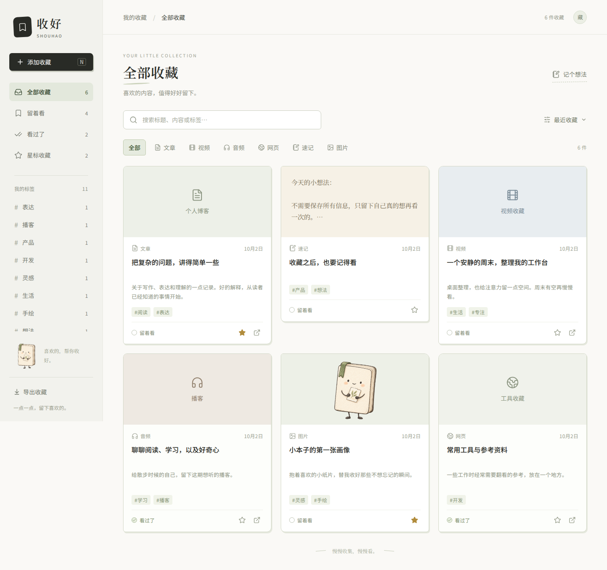

# 收好 Shouhao

一个面向个人的收藏应用。把链接、速记与图片收进来，加上标签，留给有空时的自己。

初版为适配电脑和手机浏览器的 Web 应用。React + TypeScript + Vite，Node.js + Express + SQLite；前后端在一个仓库，生产环境由同一个服务提供页面与接口。

## 界面预览



[手机端预览](docs/screenshots/mobile.png) · [空收藏状态](docs/screenshots/desktop-empty.png)

预览图中的内容为演示数据；实际启动是空收藏库。

## 初版功能

- **链接收藏**：粘贴 URL 或 App 分享文字后自动读取标题、标签、描述、封面、来源与作者；识别文章、视频、音频、网页。保留手动修改，读取不全时提示补全，读取失败也能收藏。
- **速记和图片**：文字速记；上传 PNG/JPG/WebP/GIF，最大 8 MB，文件存入服务端。
- **收藏库**：内容卡片、搜索标题/描述/速记/来源/作者/标签，按类型、标签、状态筛选，按收藏时间排序。
- **整理**：标签、星标、待看/看过，查看详情、编辑、确认删除、重复链接检查。
- **打开原内容**：新窗口打开原链接；手机由浏览器和目标平台处理 App 跳转。
- **可选 AI 整理**：接入 OpenAI 兼容服务，根据已读取的标题、摘要或速记生成标题、摘要与标签建议，手动确认后采用。未配置时普通功能照常使用。
- **单用户访问密码**：服务端 SQLite 持久化；同一服务可在手机和电脑使用。JSON 导出收藏信息。

## 本地开发

需要 **Node.js 24.13+** 与 npm。

```bash
npm ci
cp .env.example .env
npm run dev
```

打开 `http://localhost:5173`。Vite 将 API 和图片请求代理到本机 `3000` 端口。默认只允许本机使用，不需要密码。

## 自行部署

```bash
npm ci
npm run build
# 在 .env 设置 HOST=0.0.0.0、APP_PASSWORD=你的强密码
npm start
```

打开服务器的 `3000` 端口。手机通过同一网络或你的域名访问。公开部署应使用 HTTPS 反向代理，转发原始 Host；无需另外配置跨域。

Docker Compose：

```bash
cp .env.example .env
# 编辑 .env，为 APP_PASSWORD 设置强密码
docker compose up -d --build
```

数据保存在 Docker 命名卷 `shouhao_data`，升级容器时保留。不要用 `docker compose down -v`，它会删除数据卷。

## AI 配置

在 `.env` 中设置：

```dotenv
AI_BASE_URL=https://你的兼容服务/v1
AI_API_KEY=你的密钥
AI_MODEL=你可用的模型名称
```

重启服务后启用。密钥仅存于服务端。点击 AI 整理时，会将当前收藏的标题、摘要和最多 12000 字的速记发送给所配置的服务。图片不会发送；不会自动访问链接全文。建议需要手动采用。

## 验证

```bash
npm test                 # 数据持久化、接口、鉴权、上传、链接识别与 SSRF 边界
npm run build            # 前后端 TypeScript 检查与前端构建
npx playwright install chromium
npm run test:e2e         # 桌面收藏闭环、移动端布局与图片上传
```

CI 自动运行这些检查。测试使用临时数据目录，不覆盖真实收藏。

## 数据与备份

默认目录为 `data/`，包括 `shouhao.sqlite`、SQLite WAL 文件和 `uploads/`。完整备份应先停止服务，再复制整个目录或 Docker 数据卷。界面 JSON 导出仅包含收藏记录，不包含图片字节；图片路径仍指向原服务，因此不能代替完整备份。初版尚无 JSON 导入功能。

删除收藏不会立即物理删除上传的图片，以避免编辑、共享封面或中途取消时误删；初版没有孤立图片清理功能。原网页封面使用外部地址，目标网站的防盗链或地址失效可能影响显示。

## 范围与限制

目前登记 45 个常用平台，覆盖视频、图文社交、技术知识、新闻资讯和音频音乐；支持范围、解析方式、实测结果与样本见[平台识别支持](docs/platform-support.md)。部分平台增加页面初始数据和正文规则，其余使用通用元数据提取。登录、验证码和已识别的错误页会提示限制并保留原链接；登记平台不等于所有链接都可完整读取。

- 单用户初版，不提供注册、多用户、复杂文件夹、播放器、阅读器、播放进度、平台账号绑定、位置或录音。
- 链接识别读取公开 HTML 的 Open Graph / Twitter 元数据、JSON-LD 结构化数据，以及正文标题、作者和图片；标签来自网页关键词、文章标签或分享文字中的话题，不凭空生成。分享文字中的标题可在网页读取失败时补全。纯动态页面、登录或访问限制仍可能导致字段缺失，界面会提示补全。分享文字支持提取其中的完整 HTTP(S) 链接。
- Web 版直接由浏览器打开原链接；没有原生 App 的内置浏览器，也不能保证目标平台一定唤起 App。
- 搜索与筛选目前在客户端执行，适合个人收藏；大规模数据需要服务端分页和全文索引。
- 会话保存在内存中，服务重启后需要重新登录。

更多内容见 [产品范围](docs/product-v1.md) 和 [架构说明](docs/architecture.md)。
